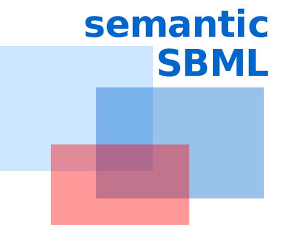

# semanticSBML 3

Check, annotate, merge and compare SBML models using their semantic
(MIRIAM / identifiers.org) annotations.

This is a port to current Python (3.10 or newer) of the core of semanticSBML,
developed 2005–2011 at the Max Planck Institute for Molecular Genetics and
Humboldt University Berlin (Falko Krause, Marvin Schulz, Jannis Uhlendorf,
Wolfram Liebermeister, Anselm Helbig, Timo Lubitz, Stefan Stiller, Gady Goldsobel,
Claudia Beck). It is based
on the last state of the SourceForge repository (trunk, revision 3402, version 1.1.0).

Licence: GPL 3 (see `COPYING`).

## Installation

```
cd semanticsbml3
python3 -m venv .venv
.venv/bin/pip install -e .
.venv/bin/semanticsbml build-database
```

This installs the command `semanticsbml` into `.venv/bin` and builds the annotation
database (see below; needs an internet connection, a few minutes). The pictures of
`semanticsbml view` need [Graphviz](https://graphviz.org) (`sudo apt install graphviz`).

## Usage

```
semanticsbml check        MODEL.xml            # report missing/duplicate annotations, atom balance
semanticsbml view         MODEL.xml -o m.svg   # picture of the reaction network (.svg .png .pdf .dot)
semanticsbml annotations  MODEL.xml            # table of all annotations (--missing, --tsv)
semanticsbml search       "glucose"            # look up a name in the annotation database
semanticsbml annotate     MODEL.xml -o OUT.xml --auto
semanticsbml annotate     MODEL.xml -o OUT.xml --add GLCi ChEBI CHEBI:17234 is
semanticsbml annotate     MODEL.xml -o OUT.xml --remove GLCi ChEBI CHEBI:17234
semanticsbml annotate     MODEL.xml -o OUT.xml --copy-from OTHER.xml
semanticsbml merge        A.xml B.xml -o MERGED.xml
semanticsbml match        A.xml B.xml          # corresponding elements, by similarity
semanticsbml similarity   A.xml B.xml C.xml    # table of model similarities
semanticsbml similarity   --query A.xml --dir FOLDER   # rank the models of a folder
```

`semanticsbml COMMAND --help` lists the options of each command.

## Browser interface

```
semanticsbml gui                    # or: semanticsbml gui MODEL1.xml MODEL2.xml
```

opens a page in the web browser (address `http://127.0.0.1:8765/`). Load models by
dropping the files onto the page; the tabs do the same things as the commands:
**Annotations** (list, search the database, add, remove, annotate automatically, copy
from another model), **Check**, **Network** (picture), **Merge**, **Match**,
**Similarity**, **Database** (name search). Models live in the memory of the program
while it runs: use "Download SBML" to keep a changed or merged model. The program
serves this computer only and sends nothing elsewhere; stop it with Ctrl-C in the terminal.

**Annotate.** `--auto` annotates every element without annotation whose name
occurs exactly once in the database. `search` shows what the database offers for a
name; `--add ELEMENT DATABASE IDENTIFIER [QUALIFIER]` adds one annotation by hand.

**Merge.** Elements whose annotations agree are joined; everything else is taken
over from each model. Where joined elements differ (values, formulas, units,
reaction participants) the model named first wins. A report lists the joined
elements and the differences, and says whether the result is valid SBML. Models
that contradict each other (e.g. a species set by a rule in one model and by
reactions in the other) give an invalid result that has to be repaired by hand;
changing the order of the models often helps.

**Match** finds corresponding elements more tolerantly than merge: it also uses
relations between database entries (D-glucose *is a* glucose) and the
neighbourhood of an element in the network. It only reports, it does not merge.

**Similarity** compares whole models (0 = nothing in common, 1 = same annotations).

## The annotation database

The annotation database holds the names of database entries, the links between
databases (a ChEBI entry and the KEGG compound it corresponds to) and the relations
between entries (D-glucose *is a* glucose). It is needed for names, for `search`,
`--auto`, `check`, `match` and `similarity`, and for merging. It is not part of the
repository; it is built on your computer from current public resources:

```
semanticsbml build-database     # download the sources and build data/db
semanticsbml database           # which versions are in use
```

`build-database` downloads about 90 MB into `data/downloads` and builds the
database in `data/db` (about 65 MB; the build itself takes less than a minute).
Run it again to get newer versions. Sources:

| source | what is taken |
|---|---|
| [ChEBI](https://www.ebi.ac.uk/chebi/) | chemical entities: names, synonyms, relations, formulas, links to KEGG compound identifiers; the manually curated entries, those linked to KEGG compounds and their parents (about 70 000; `--all-chebi` takes all 220 000) |
| [Gene Ontology](https://geneontology.org) | terms, synonyms, relations, links to EC numbers and KEGG reaction identifiers |
| [SBO](https://github.com/EBI-BioModels/SBO) | Systems Biology Ontology |
| [identifiers.org](https://identifiers.org) | names of the databases that annotations point to |
| NCBI Taxonomy | small extract (1500 organisms) made by the original project in 2009, in `data/` |

Nothing is taken from KEGG. Annotations with KEGG identifiers are understood through
the links that ChEBI and the Gene Ontology give (C00293 is CHEBI:17234, glucose);
KEGG reaction equations are not known.

The original program used a database built in 2011 from KEGG, ChEBI, Gene Ontology,
InterPro, SGD and others. It is not distributed with this repository, and the code
for importing KEGG, InterPro and SGD was removed; a database of that kind can still
be used with `semanticsbml --data FOLDER ...`. Another data folder can also be chosen
with the environment variable `SEMANTICSBML_DATA`.

## Tests

```
.venv/bin/pip install pytest
.venv/bin/python -m pytest
```

Most tests need the annotation database and are skipped without it.
`tests/test_against_original.py` compares with results of the original program and
needs its database of 2011 (see `tests/reference_py2/README.md`).

## Layout

| folder | content |
|---|---|
| `semanticSBML/` | check, annotate, merge, view, similarity of elements; `cli.py` is the command line tool, `webgui.py` + `webgui.html` the browser interface |
| `libSBAnnotation/` | annotation database, MIRIAM resources, SBO |
| `libModelSimilarity/` | similarity and clustering of whole models |
| `data/` | resource files; `data/db` (the annotation database) and `data/downloads` are created by `build-database` |
| `tests/` | tests and example models (BioModels 61, 64, 239) |

See `CHANGES.md` for what differs from the original program.
